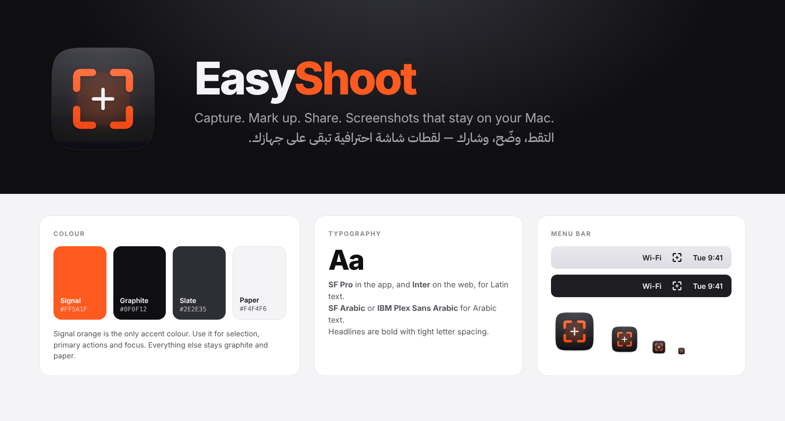

# EasyShoot brand

## Idea
**Graphite Crosshair.** The selection corners and crosshair are what every Mac user sees when taking a screenshot. On a dark graphite tile with one signal-orange accent, the mark reads as a precise professional tool, not a toy.

## Assets
| File | Use |
|---|---|
| `AppIcon.svg` | Master app icon (1024 × 1024 macOS squircle grid) |
| `AppIcon-1024.png` | Rendered icon for stores, the website and social media |
| `MenuBarMark.svg` | Single-colour mark for the menu bar, favicons and monochrome uses |
| `../Resources/AppIcon.iconset` | All icon sizes; `build-app.sh` turns them into `AppIcon.icns` |
| `../website/favicon.svg`, `../website/og.png` | Website favicon and 1200 × 630 social preview |

## Colour
| Name | Hex | Use |
|---|---|---|
| **Signal** | `#FF5A1F` | The only accent: selection, primary buttons, focus, highlights |
| **Graphite** | `#0F0F12` | Icon body, dark surfaces, text on light backgrounds |
| **Slate** | `#2E2E35` | Top of the icon gradient, secondary dark surfaces |
| **Paper** | `#F4F4F6` | Light backgrounds, text on graphite |

Signal orange must cover less than ~10% of any layout. Don't add gradients or other accent colours, and don't put purple, glow or sparkle effects on the mark.

## Type
- **App:** SF Pro, and SF Arabic for Arabic (the system fonts).
- **Web and marketing:** **Bricolage Grotesque** (800) for headlines, **Instrument Sans** for body text, and **JetBrains Mono** for keys and specs.
- **Arabic on the web:** **Readex Pro** for both headlines and body text.
- **Headlines:** extra-bold, with letter spacing of −0.03 em (0 for Arabic).

## Wordmark
**Easy**Shoot, with "Easy" in graphite (or paper on dark) and "Shoot" in signal. It's one word with a capital S.

## Voice
Short, confident and plain. *Capture. Mark up. Share.*
Arabic: *التقط، وضّح، وشارك.*
