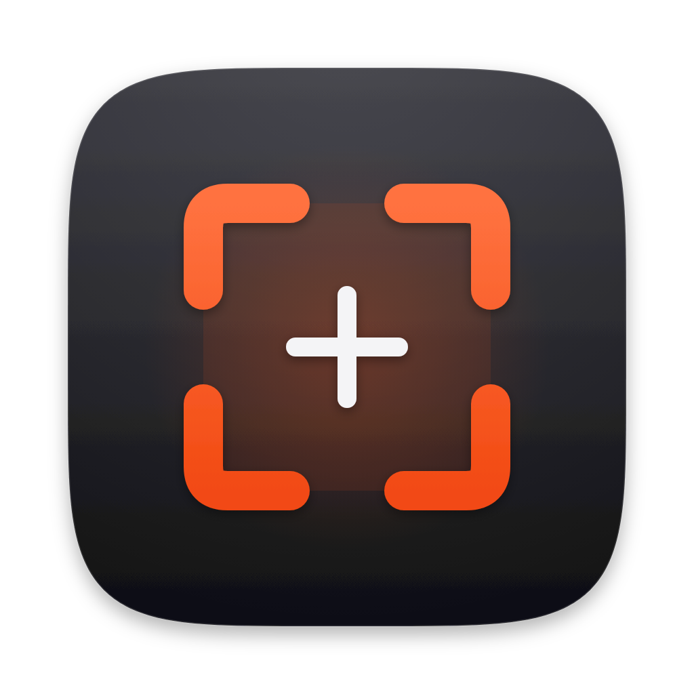
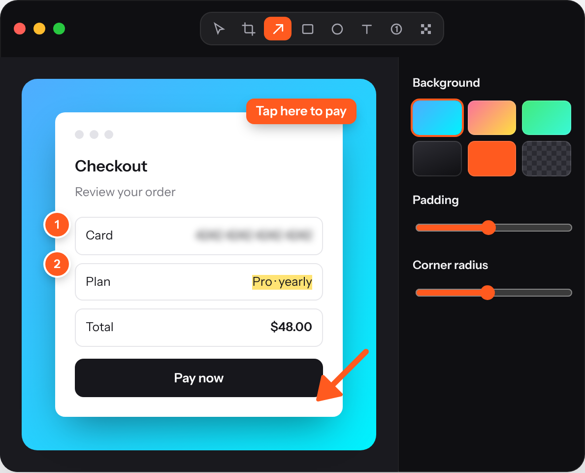
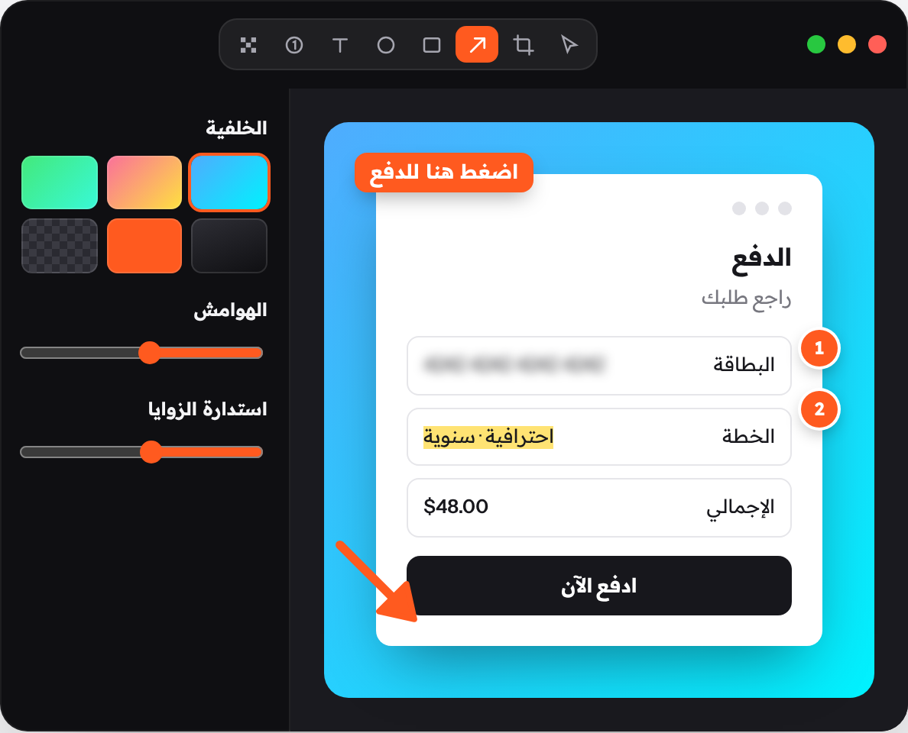

<div align="center">



# EasyShoot

### Screenshots that explain themselves.

Capture any part of your Mac's screen, mark it up, frame it on a clean background and share it in seconds.<br>
Free, open source, and private: your screenshots never leave your Mac.

[](https://github.com/Haythamasalama/easyshoot/actions/workflows/build.yml)
[](https://github.com/Haythamasalama/easyshoot/releases/latest)
[](LICENSE)


[](CONTRIBUTING.md)

**[⬇ Download for Mac](https://github.com/Haythamasalama/easyshoot/releases/latest)** &nbsp;·&nbsp; [Website](https://easyshoot.haythamasalama.me) &nbsp;·&nbsp; [Features](#features) &nbsp;·&nbsp; [Build from source](#build-from-source) &nbsp;·&nbsp; [Contribute](#contributing)

<br>



</div>

## Why EasyShoot

A good screenshot usually needs four apps: one to capture, one to crop, one to annotate and one to put it on a nice background. Long pages need several shots joined by hand, and Arabic text often comes out backwards. EasyShoot does all of it in one window, behind one shortcut, and it never uploads anything.

## Features

| | |
|:--|:--|
| 📸 **Capture** | Area, window and fullscreen capture from the menu bar, each on a shortcut you can record yourself. |
| 📜 **Scrolling capture** | Capture whole web pages, long chats and documents in any app. Scroll by hand or let Auto-scroll do it, and sticky headers appear only once. |
| ⚡ **Quick Access** | A floating thumbnail after every capture: copy, save, annotate, or drag it straight into Slack or Mail. |
| ✏️ **Annotate** | Arrows, lines, rectangles, ellipses, text, numbered counters, highlighter, pen and pixelate. Every mark stays editable. |
| 🔤 **Arabic & right-to-left** | Arabic and Hebrew text writes right-to-left automatically, with correct letter shaping. Use any installed font or download one from Google Fonts. |
| 🖼 **Background tool** | Gradients, solid colours or transparent, with padding, rounded corners, shadow, aspect ratios and alignment. |
| 🎨 **Presets** | Save your style as a preset and make it the default, so every new screenshot matches your brand. |
| 📤 **Export** | PNG, JPEG, HEIC or TIFF, resized by percent or to an exact width, with the final size shown as you go. |
| 🌍 **Five languages** | English, العربية, Français, Español and Deutsch. Arabic switches the whole interface to right-to-left. |
| 🔒 **Private** | No account, no cloud, no analytics. The app only goes online when you download a Google font. |

On **macOS 26**, EasyShoot uses Liquid Glass. On macOS 14 and 15 it falls back to the standard materials.

<div align="center">

<br><sub>The same screen in Arabic: the interface and the notes run right-to-left.</sub>
</div>

## Install

1. Download **EasyShoot.zip** from the [latest release](https://github.com/Haythamasalama/easyshoot/releases/latest), unzip it, and move **EasyShoot.app** to **Applications**.
2. The app isn't notarized yet, so macOS blocks it the first time you open it. Go to **System Settings → Privacy & Security** and click **Open Anyway**, or run:
   ```bash
   xattr -cr /Applications/EasyShoot.app
   ```
3. Open EasyShoot and click **Allow** in the Welcome window to grant **Screen Recording** permission.

> [!TIP]
> EasyShoot lives in the **menu bar**, not the Dock. If you can't see its icon (MacBooks with a notch can hide it), use the shortcuts, or open the app again to bring back the Welcome window.

**Requirements:** macOS 14 Sonoma or later, on Apple silicon or Intel.

## Shortcuts

| Action | Default |
|:--|:--|
| Capture area (press <kbd>Space</kbd> for window mode) | <kbd>⌥</kbd> <kbd>⇧</kbd> <kbd>⌘</kbd> <kbd>4</kbd> |
| Capture window | <kbd>⌥</kbd> <kbd>⇧</kbd> <kbd>⌘</kbd> <kbd>5</kbd> |
| Capture fullscreen | <kbd>⌥</kbd> <kbd>⇧</kbd> <kbd>⌘</kbd> <kbd>3</kbd> |
| Scrolling capture | <kbd>⌥</kbd> <kbd>⇧</kbd> <kbd>⌘</kbd> <kbd>6</kbd> |
| Annotate the clipboard image | <kbd>⌥</kbd> <kbd>⇧</kbd> <kbd>⌘</kbd> <kbd>7</kbd> |

Change any of them in **Settings → Shortcuts**. In the editor:
- Single letters switch tools: <kbd>A</kbd> arrow, <kbd>T</kbd> text, <kbd>R</kbd> rectangle, <kbd>C</kbd> crop, <kbd>N</kbd> counter.
- <kbd>⌘</kbd><kbd>+</kbd> and <kbd>⌘</kbd><kbd>−</kbd> resize text.
- Holding <kbd>⇧</kbd> keeps lines straight and shapes square.

## Build from source

```bash
git clone https://github.com/Haythamasalama/easyshoot.git
cd easyshoot
swift test                    # unit tests
./scripts/build-app.sh        # builds build/EasyShoot.app
open build/EasyShoot.app
```

- You need **Xcode 15 or later**. Xcode 26 adds the Liquid Glass look.
- `UNIVERSAL=1 ./scripts/build-app.sh` builds for both Apple silicon and Intel.
- You can open `Package.swift` in Xcode to edit the code. Run the app through `build-app.sh`, though, so macOS can grant it permissions.

<details>
<summary><b>How the code is organized</b></summary>

```
Sources/EasyShoot/
  App/          entry point, menu bar, global shortcuts, Welcome window, capture flow
  Capture/      screencapture wrapper, permissions, region picker, scrolling capture + stitcher
  Editor/       models, renderer (shared by canvas and export), canvas, SwiftUI editor, fonts
  Export/       encoding, clipboard, saving
  QuickAccess/  the floating thumbnail after a capture
  Settings/     settings window, preferences, presets, shortcut recorder
  Support/      brand colours, Liquid Glass helpers, localization
Resources/      Info.plist, app icon, translations (*.lproj)
Tests/          stitcher, right-to-left detection, layout and render tests
website/        the marketing site, in five languages
Branding/       icon sources and the brand guide
```

One `Renderer` draws both the editor canvas and the exported image, so what you see is what you save. The project uses only Apple frameworks, with no third-party dependencies.

</details>

## Roadmap

- [x] Area, window, fullscreen and scrolling capture
- [x] Annotations, background tool, presets and export
- [x] Arabic and right-to-left text, five interface languages
- [ ] Screen recording to video and GIF
- [ ] Text recognition (copy text from a screenshot)
- [ ] Notarized builds and Homebrew cask
- [ ] More languages: send a pull request with yours!

Have an idea? [Open a feature request](https://github.com/Haythamasalama/easyshoot/issues/new?template=feature_request.yml).

## Contributing

Contributions of every size are welcome, whether it's a bug report, a translation, a design idea or a pull request.

1. Read the **[contributing guide](CONTRIBUTING.md)**. It covers setup, code style and how to add a language.
2. Pick an issue labelled [`good first issue`](https://github.com/Haythamasalama/easyshoot/labels/good%20first%20issue), or open one to discuss your idea.
3. Send a pull request. CI builds the app, runs the tests, checks the translations and launches the app.

Please follow the [Code of Conduct](CODE_OF_CONDUCT.md). To report a security issue, see [SECURITY.md](SECURITY.md).

<a href="https://github.com/Haythamasalama/easyshoot/graphs/contributors">
  
</a>

## License

EasyShoot is released under the [MIT License](LICENSE).

<div align="center">
<br>
Made by <a href="https://haythamasalama.me"><b>Haytham A. Salama</b></a> · <a href="https://github.com/Haythamasalama">GitHub</a>
<br><br>
If EasyShoot saves you time, give it a ⭐ to help others find it.
</div>
